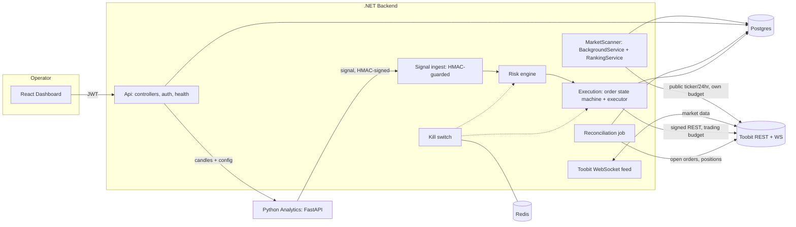
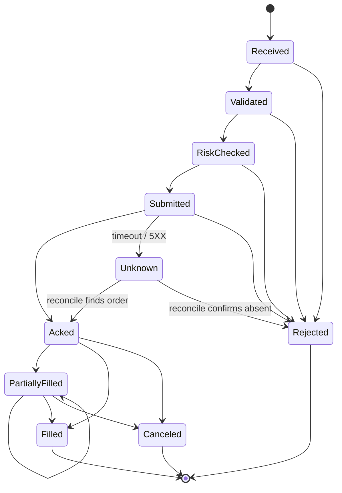

# Architecture

Automated analysis and trading platform for Toobit USDT-M futures.

## Modules

| Module | Tech | Responsibility |
|---|---|---|
| A. Backend | .NET 8, ASP.NET Core, EF Core, Polly, Serilog, OTel | Scanner, risk, order execution, reconciliation, auth, API. **Sole** component that talks to Toobit. |
| B. Analytics | Python 3.12, FastAPI, pandas/numpy, ONNX Runtime | Option-proxy signals (delta/gamma/theta/vega, IV/HV), ML scoring, backtesting. Never calls Toobit. |
| C. Dashboard | React 18, TypeScript, Vite, TanStack Query | Operator UI. Holds no credentials. |
| D. Contracts | OpenAPI / JSON Schema in `contracts/` | Typed boundaries; TS client and Python models are generated from them. |

## C4 component view



## Signal to order to reconcile

```mermaid
sequenceDiagram
  autonumber
  participant PY as Python Analytics
  participant IN as Signal Ingest
  participant RK as Risk Engine
  participant EX as Order Executor
  participant TB as Toobit
  participant RC as Reconciliation
  participant DB as Postgres

  PY->>IN: POST /internal/signals (HMAC, correlation id)
  IN->>DB: persist Signal (shadow mode logs only)
  IN->>RK: evaluate(signal)
  RK->>DB: RiskEvent (accept or reject)
  RK->>EX: approved order intent (bounded channel)
  EX->>DB: Order Received, ClientOrderId persisted
  EX->>DB: Validated, RiskChecked
  EX->>TB: POST order (limit, SL/TP attached)
  alt 2xx
    TB-->>EX: ack
    EX->>DB: Submitted, Acked
  else timeout or 5XX
    EX->>DB: Unknown
    RC->>TB: query by ClientOrderId
    TB-->>RC: actual state
    RC->>DB: resolve Unknown, ReconciliationEvent
  else 429 or 418
    EX->>EX: jittered backoff, honor reset timestamp
  end
  loop every N seconds
    RC->>TB: open orders + positions
    RC->>DB: compare; on divergence raise ReconciliationEvent and pause symbol
  end
```

## Order state machine



## Layering (.NET)

`Api -> Application -> Domain <- Infrastructure`. Domain has no package or project reference to Infrastructure. `MarketScanner`, `Risk`, `Execution` are feature libraries that depend on Domain and Application abstractions only; Infrastructure supplies adapters (Toobit client, EF repositories, Redis).

## Folder tree

```
toobit-platform/
  ADRs/  RUNBOOKS/  contracts/  observability/
  backend/
    src/ Domain Application Infrastructure Api MarketScanner Risk Execution
    tests/ Toobit.UnitTests Toobit.IntegrationTests
  analytics/ app analytics signals ml backtesting tests
  frontend/ src/features src/shared src/i18n
  .github/workflows/ ci.yml cd.yml
  docker-compose.yml  .env.example
```

## Cross-cutting

- **Resilience**: every outbound call has timeout, jittered exponential retry (idempotent calls only), circuit breaker, bulkhead. Scanner uses its own `HttpClient` and rate-limit budget so it cannot starve trading calls.
- **Backpressure**: bounded `Channel<T>` between scanner, signal evaluator, order executor; `BoundedChannelFullMode.DropWrite` plus a counter and warning, never blocks.
- **Observability**: Serilog JSON, OTel traces and metrics, correlation id header `X-Correlation-Id` end to end.
- **Idempotency**: `ClientOrderId` (UUIDv7) persisted before submit; `Idempotency-Key` on mutating endpoints.
- **Degradation**: scanner failure serves last-known-good with `scanner_stale=1`; Redis loss falls back to the DB kill-switch flag; Python down means no new signals, existing SL/TP stay on the exchange.
